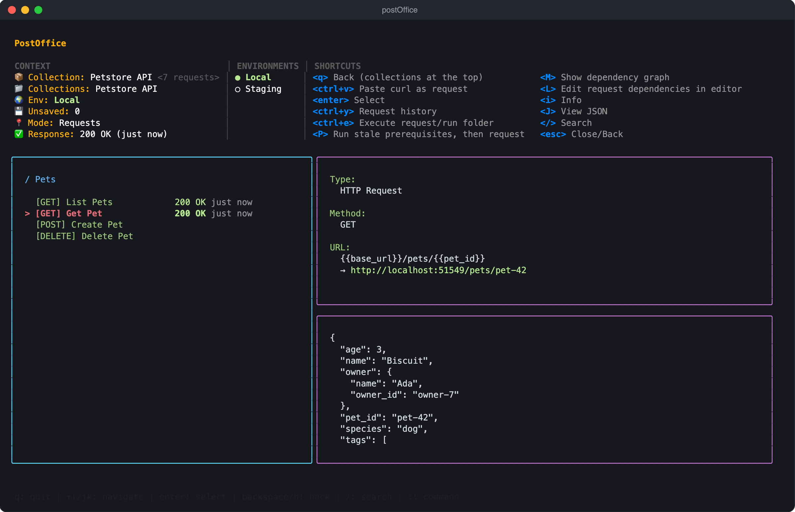
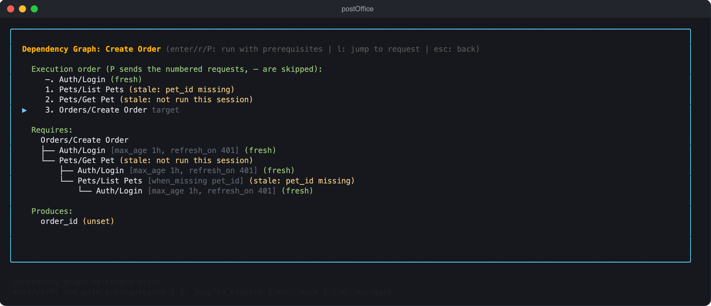
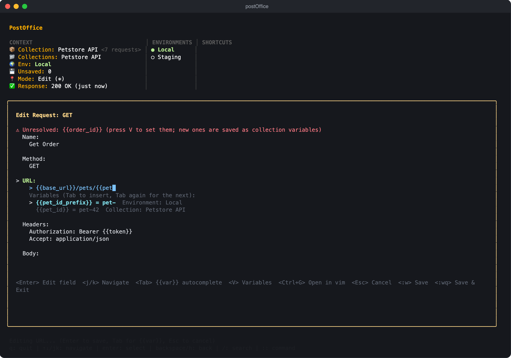

# PostOffice

keyboard-driven TUI for browsing, editing and running Postman collections.

Send HTTP, gRPC, Service Bus and AMQP requests, chain them with dependencies, script them with Postman-style tests and workflows, and run the same collections headless in CI — without leaving the terminal.



### Chain requests with dependencies

Declare what each request requires and produces next to the collection. 



### Edit with autocomplete

Edit the URL, headers and body in place. `{{` suggests variables with their resolved value, scope and the definitions they shadow. Plain words suggest values of matching JSON fields from history and saved responses (`pet_` → `pet_id`). 



## Install

```bash
make build      # build ./postOffice
make install    # install to $GOPATH/bin
```

Or build directly with Go:

```bash
go build -o postOffice
```

Run with `postOffice`, or use `postOffice --log /tmp/postoffice.log` to write logs to a file.

## Getting started

1. Launch the app and load a collection with `:l ~/postman/api.json`, and an environment with `:le ~/postman/dev.json`.
2. Press `enter` to open folders and `ctrl+e` to send a request. `tab` shows the request and its response side by side.
3. Press `ctrl+n` to switch environment and `e` to edit the selected request.

Loaded collections and environments reload automatically on subsequent launches. Use `:session` to restore your previous view.

## Commands and keys

| Command | Action |
|---|---|
| `:l <path>` / `:le <path>` | Load a collection / environment |
| `:r` / `:env` / `:var` | Requests / environments / variables |
| `:wf` | Browse workflows |
| `:hist` | Request history |
| `:deps` | Dependency graph of the selected request |
| `:session` | Restore previous view |

| Key | Action |
|---|---|
| `j` / `k`, `enter` | Navigate and open |
| `/` | Search |
| `ctrl+e` | Send the request, run the folder or workflow |
| `P` | Run stale prerequisites, then the request |
| `e` / `V` | Edit request / its variables |
| `t` | Timing breakdown of the response |
| `T` | Toggle the top bar |
| `q` / `ctrl+c` | Back / quit |

See [all commands and shortcuts](docs/commands-and-keys.md).

## Run headless

Run requests, folders, collections and workflows without the TUI, with JUnit or JSON reports for CI:

```bash
postOffice run collection.json --folder smoke -e ci.json --output junit --report results.xml
```

See the [headless CLI](docs/cli.md) for selection, listing, merging and aliases.

## Documentation

- [Editing requests and variables](docs/editing.md)
- [Request dependencies](docs/dependencies.md)
- [Scripts and tests](docs/scripts.md)
- [Workflows](docs/workflows.md)
- [Request history and timing](docs/history.md)
- [gRPC](docs/grpc.md)
- [Headless CLI](docs/cli.md)

## Configuration

State is stored in `~/.postoffice_*.json` files: loaded collections, session, history, saved responses, favorites and aliases. Dependencies and workflows live next to each collection.

See [configuration](docs/configuration.md) for the files and environment variables.

## Development

```bash
make test    # race detector and coverage
make lint    # golangci-lint
make fmt
```
