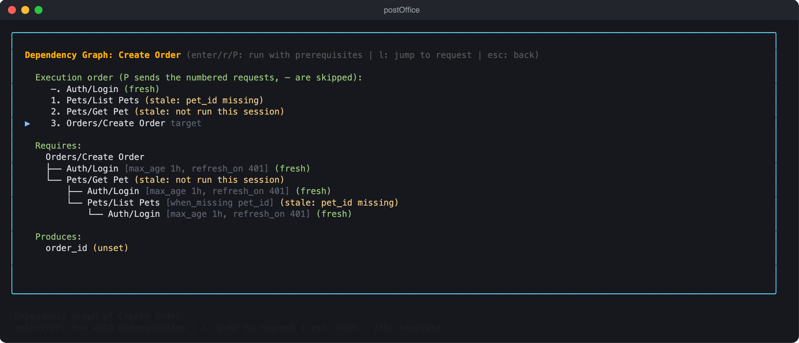

# Request dependencies

Declare what a request `requires` and `produces`. Press `P` to run its stale prerequisites first.

Dependencies live next to the collection, so the collection JSON stays Postman-importable. For `MyApi.postman_collection.json` the file is `MyApi.postman_collection.dependencies.yaml`.

```yaml
requests:
  Users/Get User:
    requires: [Auth/Login]
    produces: [userId]
  Auth/Login:
    requires: []
    produces: [token]
```

Requests are referenced by `Folder/Request` path, like workflow steps.

A prerequisite is stale when it hasn't run successfully this session, a variable it produces is unset or empty, or a variable it used (`{{name}}` in its URL, headers or body, other than the ones it produces) has changed since it last succeeded. Errors, non-2xx statuses, skipped sends and failed tests are not successful.

## Freshness rules

A `requires` entry can also be a mapping with freshness rules:

```yaml
requests:
  Users/Get User:
    requires:
      - request: Auth/Login
        max_age: 15m       # stale once the last success is older
        refresh_on: [401]  # on 401: re-run Auth/Login, then retry Get User once
      - request: Users/Create User
        when_missing: [userId]  # run only while userId is unset, even if it never ran this session
```

`max_age` takes Go durations (`90s`, `15m`, `1h`) and cannot be combined with `when_missing`. `refresh_on` applies to `P` runs, including requests whose prerequisites are all fresh. Unknown keys are errors, so a misspelt rule is not ignored.

## Running

| Key | Action |
|---|---|
| `P` | Run stale prerequisites in dependency order, then the request |
| `L` | Edit the dependency file in `$EDITOR` (adds an entry for the selected request) |
| `M` | Show the dependency graph (also `:deps`) |

Fresh prerequisites are skipped. A failing or cancelled prerequisite stops the chain, and so does one that leaves a produced variable unset.

Request info (`i`) shows the dependency tree:

```
Get User
     ├── requires → Auth/Login [max_age 15m, refresh_on 401] (stale: ran 16m ago, max_age 15m)
     └── produces → userId (unset)
```

Unknown paths and cycles are reported and block `P` until fixed.

## Dependency graph

`M` (or `:deps`) on a request opens its whole dependency graph:



- The execution order is every transitive prerequisite in the order `P` runs them. Numbered rows are sent; `–` rows are fresh or only needed by fresh requests.
- Each requires edge shows its rules and status: fresh, stale with the reason, failed (red) or missing. A request already expanded is not expanded again, and an edge back up the path is marked `↻ cycle`.
- Cycles and unknown paths are listed under Problems before anything runs; the execution order is left out while the graph has a cycle.
- The cursor opens on the target. `j`/`k` select a request; `enter`, `r`, `P` or `ctrl+e` run the selected request after its stale prerequisites (the graph stays open and updates as they complete), `l`/`→` jump to it in the requests view and `esc`/`q` go back.

In the combined view, a request's dependencies come from its own collection's file.
